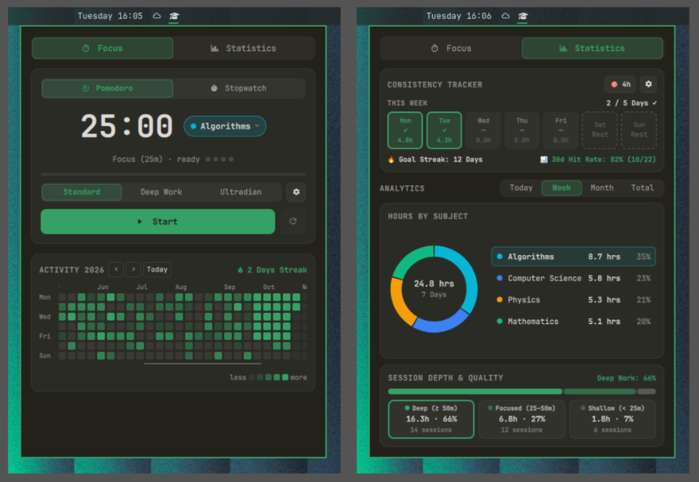

# Study Tracker

An Omarchy bar plugin for tracking study sessions, subjects, consistency goals, and session depth, without leaving your desktop.



## Features

### Focus Timer
- **Pomodoro** with presets: *Standard*, *Deep Work*, *Ultradian*, plus custom intervals
- **Stopwatch** for open-ended sessions
- Desktop notifications when a phase ends
- Sessions of one minute or longer are saved automatically

### Subjects
- Instant search
- Create subjects
- Archive subjects you no longer study

### Activity Heatmap
- Full-year scrollable calendar grid
- Jump to any month
- Hover for per-day details
- Streak counter

### Statistics
- **Daily goal tracker** in hours or blocks, with optional weekend rest days
- **Subject breakdown** as a donut chart
- **Session depth** breakdown: *Deep*, *Focused*, *Shallow*

## Installation

```bash
omarchy plugin add https://github.com/sersah/Study-Tracker.git --enable
```

Update or remove:

```bash
omarchy plugin update io.github.sersah.study-tracker
omarchy plugin remove io.github.sersah.study-tracker
```

## Usage

### Bar widget

| Action | Result |
| --- | --- |
| Left click | Toggle the panel |
| Right click | Start / pause the timer with selected subject |

### Panel shortcuts

| Key | Action |
| --- | --- |
| `Space` / `Enter` | Start / pause |
| `r` / `s` | Reset |
| `m` | Switch mode (Pomodoro / Stopwatch) |
| `t` | Open subjects |
| `←` / `→` | Switch tabs |
| `Esc` | Close the panel |

## Data

All data is stored locally in a single JSON file:

```
~/.local/share/study-tracker/data.json
```

## Project structure

```
BarWidget.qml     Status bar widget
Panel.qml         Main panel UI
ColorPicker.qml   Color picker component
Model.js          Data and logic
manifest.json     Plugin manifest
test.js           Tests
preview.png       Screenshot
```

## Development

This project was fully built with AI assistance. Tested through daily use, no formal review of the code.

## License

[MIT](LICENSE)
